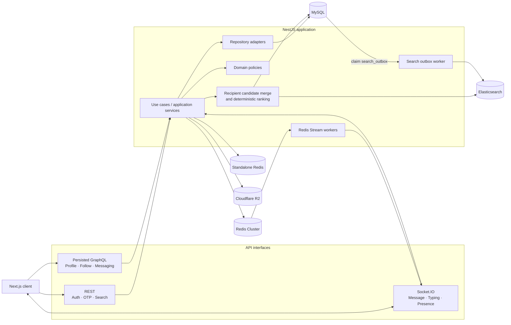
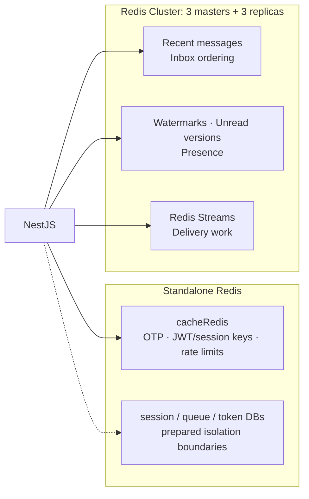

# Instagram-style Social Backend

[](https://github.com/hieumn04/social-platform-backend/actions/workflows/ci.yml)


A portfolio backend that recreates the engineering-heavy parts of an Instagram-style social product: relationship state, hybrid ranked recipient discovery, secure OTP signup, cursor-based direct messaging, private media and realtime delivery.

## Why this project is interesting

- **Hybrid API:** REST for auth/search, allowlisted persisted GraphQL for composed social data, and Socket.IO for realtime events.
- **Two Redis roles:** standalone Redis for OTP/JWT/rate limiting; Redis Cluster for messaging cache, presence and stream delivery.
- **Hybrid discovery:** Elasticsearch retrieves global username/name candidates while MySQL contributes follow, recent-DM and second-degree relationship signals for deterministic ranking.
- **Reliable indexing:** user writes and search events share a MySQL transaction; an outbox worker updates versioned Elasticsearch indexes without dual writes.
- **Reliable messaging:** idempotency keys, opaque cursors, transactional writes, seen watermarks and versioned unread state.
- **Private media:** direct-to-R2 uploads, server-side `HEAD` verification and short-lived signed delivery URLs.

## System at a glance



## Tech stack

| Area              | Technologies                                                  | Role                                                        |
| ----------------- | ------------------------------------------------------------- | ----------------------------------------------------------- |
| Runtime           | Node.js 20, TypeScript 5.7, NestJS 11                         | Modular backend and dependency injection                    |
| API               | REST, Apollo GraphQL, persisted `doc_id`, Socket.IO           | HTTP, typed composed reads and realtime communication       |
| Data              | MySQL 8.4, TypeORM, parameterized raw SQL                     | Transactions plus optimized read projections                |
| Search            | Elasticsearch 9.3, versioned aliases, transactional outbox    | Global candidate retrieval with safe MySQL fallback         |
| Distributed state | Redis 7.4, Redis Cluster, Redis Streams                       | Auth state, cache, presence, unread state and delivery work |
| Object storage    | Cloudflare R2, AWS S3 SDK                                     | Presigned private-media upload and delivery                 |
| Security          | Passport JWT, bcrypt, HttpOnly cookies, Helmet, rate limiting | Authentication and request/session protection               |
| Delivery          | Web Push, Nodemailer                                          | Browser notifications and OTP email                         |
| Tooling           | Docker Compose, Swagger, Jest, GitHub Actions                 | Local infrastructure, API discovery and CI verification     |

## Implemented features

| Area          | Working scope                                                                                |
| ------------- | -------------------------------------------------------------------------------------------- |
| Social graph  | Follow public accounts, request private accounts, viewer-relative friendship status          |
| Profile       | Initial profile by immutable `userID`, privacy, counters and friendship state                |
| Discovery     | Follow, recent-DM, second-degree and global candidates; deterministic top-10 ranking         |
| Messaging     | Mailbox/thread reads, opaque cursor pagination, idempotent text/image/inline-share sends     |
| Message state | Send status, seen watermarks, unread summaries, cache invalidation and Redis Stream delivery |
| Realtime      | Authenticated Socket.IO, presence, heartbeat and typing events                               |
| Signup        | Username availability, OTP request/status/resend/verify, account registration                |
| Media         | Presigned R2 upload, MIME/size/dimension checks, `HEAD` verification and signed reads        |

## API design

| Surface           | Used for                                                                        | Entry point                           |
| ----------------- | ------------------------------------------------------------------------------- | ------------------------------------- |
| REST              | Login/refresh/logout, OTP, username check, recipient search, push subscriptions | Resource routes such as `/auth/otp/*` |
| Persisted GraphQL | Follow, profile, ranking, mailbox, messages, media and presence                 | `POST /api/graphql`                   |
| Socket.IO         | Live messages, typing, seen and presence                                        | `WS_PATH` / `WS_NAMESPACE`            |

The public GraphQL endpoint accepts only registered numeric `doc_id` operations:

```json
{
  "doc_id": "28949219061332276",
  "variables": {
    "userID": "50344278754"
  }
}
```

Raw query documents and unknown IDs are rejected. Actor/viewer identity comes from JWT, not client variables. The internal Apollo endpoint disables Playground and introspection and limits query depth to five.

## Redis design



Four standalone logical clients are initialized, but current auth/rate-limit paths primarily use `cacheRedis`; the other clients are prepared boundaries. Redis Cluster is active in messaging and realtime state. This distinction is intentional in the documentation so the portfolio does not overclaim implementation scope.

## Architecture and correctness

Core modules use DDD-style `presentation → application → domain → repository` boundaries. Read-heavy profile/search/ranking paths use parameterized SQL; transactional message and relationship writes use TypeORM repositories and transactions. Recipient discovery retrieves candidates from relationship-aware MySQL projections and Elasticsearch in parallel, then rehydrates authorized users from MySQL before applying the final ranking.

Key correctness decisions:

- Route-level authentication uses `JwtAuthGuard` for persisted GraphQL and protected REST endpoints; refresh-token operations additionally use `SessionGuard` and `CsrfGuard`.
- `offline_threading_id` prevents duplicate messages during client retries.
- Message history uses opaque cursors instead of unstable offset pagination.
- Stable object keys are cached; expiring private delivery URLs are generated after cache reads.
- Recipient ranking prioritizes lexical match, followed users, recent Direct threads, mutual connections, interaction scores and Elasticsearch relevance, and returns at most ten results.
- The `search_outbox` table keeps user persistence and index updates atomic; versioned read/write aliases support controlled backfills and future reindexing.
- Media becomes attached only after membership checks and R2 object verification.
- Signup keeps its opaque session in a scoped `HttpOnly; SameSite=Strict` cookie.
- Redis stores an HMAC of the OTP and a hash of the signup session token.

See [Architecture](docs/ARCHITECTURE.md) for DDD boundaries, Redis topology, message sequence, high-level ER diagram and runtime status.

## Quick start

Requirements: Node.js 20+, npm, Docker Desktop and Git Bash/WSL for Redis Cluster initialization.

```powershell
Copy-Item .env.example .env.development
Copy-Item .redis-cluster.env.example .redis-cluster.env
npm ci --legacy-peer-deps

docker compose -f .\redis-local\docker-compose.yml up -d
docker compose -f .\docker-compose.elasticsearch.yml up -d
```

MySQL runs directly on the development machine; make sure the MySQL 8.4
instance configured by `DB_HOST` and `DB_PORT` is available. Replace placeholder
JWT, OTP, email, database, Redis, Elasticsearch, VAPID and R2 values in
`.env.development`, then initialize the Redis Cluster from Git Bash or WSL:

```bash
cd redis-cluster-auto
bash create-cluster.sh
cd ..
```

> The cluster script recreates local cluster containers and generated cluster data. Use it only to initialize or intentionally rebuild the development cluster.

Keep `ELASTICSEARCH_READ_ENABLED=false` while the outbox backfill is draining. Enable reads only after the index document count and outbox status have been verified; recipient search falls back to an indexed MySQL username exact/prefix query while Elasticsearch reads are unavailable.

Start the API:

```powershell
npm run start:dev
```

| Development endpoint | URL                                      |
| -------------------- | ---------------------------------------- |
| API                  | `http://localhost:3000`                  |
| Swagger UI           | `http://localhost:3000/api`              |
| Persisted GraphQL    | `POST http://localhost:3000/api/graphql` |

Swagger is available outside production. Authenticated examples require `Authorization: Bearer <access-token>`; signup requests must retain the `signup_session` cookie.

## Verification

```powershell
npm run build
npm test -- --runInBand
npm run test:e2e -- --runInBand
docker build -t instagram-style-social-backend .
```

- **27/27 unit suites — 84/84 tests**
- **1/1 E2E suite — 2/2 tests**
- CI verifies install, build, tests and the production Docker image

## Documentation

- [Architecture and data flow](docs/ARCHITECTURE.md)
- [API examples and persisted operation catalog](docs/API_EXAMPLES.md)
- [Direct-message media flow](docs/direct-message-media-flow.md)
- [Database bootstrap schema](database/init/001-schema.sql)
- [GitHub Actions workflow](.github/workflows/ci.yml)

## Current boundaries

- Posts have schema/persistence foundations; complete CRUD, profile grid and feed ranking are not implemented.
- Unfollow, accept-request and block use cases exist but are not public persisted operations yet.
- Restrict, mute and close-friend relationships currently provide domain/persistence foundations.
- RabbitMQ infrastructure is prepared but is not in the active application graph; message delivery uses Redis Streams and Socket.IO.
- Development diagnostic controllers should be removed or guarded before a public deployment.

This project intentionally favors a smaller set of end-to-end, technically deep flows over a large number of shallow CRUD modules.
