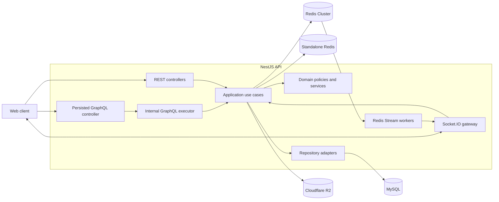
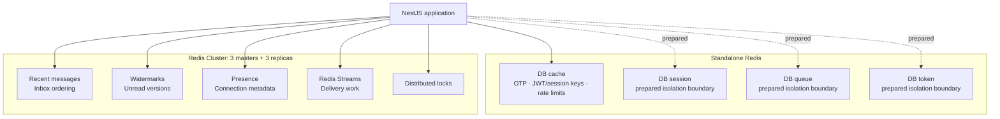
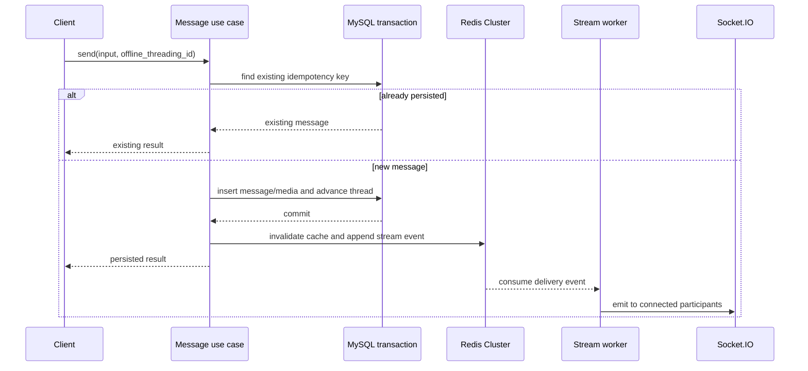
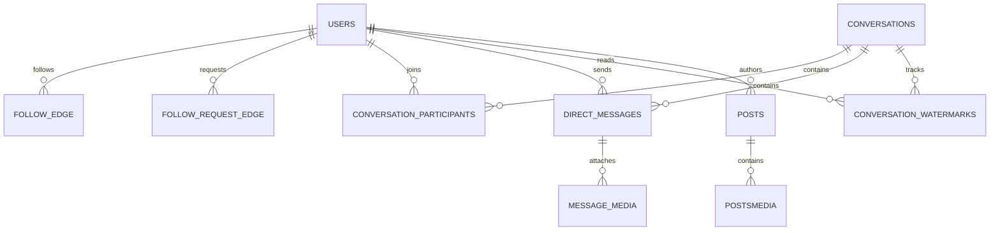

# Backend architecture

This document expands the architecture diagrams and design decisions summarized in the repository README. It describes the code that is currently wired into `AppModule` and explicitly separates working runtime paths from prepared foundations.

## System context



## DDD-style module boundaries

Core business modules use four main layers:

```text
presentation -> application -> domain
                       |
                       v
                repository port
                       |
                       v
                infrastructure
```

- **Presentation** validates transport-specific input and obtains actor identity from the authenticated request.
- **Application** coordinates use cases, transactions and cross-service work.
- **Domain** owns business policies and deterministic calculations such as share-sheet ranking.
- **Infrastructure** implements persistence, Redis, object storage and delivery adapters.

This is described as DDD-style rather than strict DDD because some older or supporting modules do not yet follow every boundary consistently.

## API surfaces

| Surface           | Workload                                                                                    | Reason                                                               |
| ----------------- | ------------------------------------------------------------------------------------------- | -------------------------------------------------------------------- |
| REST              | Authentication, OTP, username checks, recipient search, route resolution, push subscription | Natural HTTP status, query parameter and cookie semantics            |
| Persisted GraphQL | Profile, follow, mailbox, thread, messages, presence, media lifecycle, ranking              | Typed composed payloads without accepting arbitrary public documents |
| Socket.IO         | Message fan-out, typing, seen and presence                                                  | Authenticated bidirectional realtime delivery                        |

The public GraphQL transport accepts a numeric `doc_id` and a variables object. It rejects raw `query` documents and unknown IDs. The mapped document executes through the internal Apollo schema at `/internal-graphql`; Playground and introspection are disabled and query depth is limited to five.

## Redis topology



Four standalone clients are initialized against separate logical databases. Current authentication and rate-limit paths still primarily use `cacheRedis`; the remaining clients are prepared isolation boundaries. Redis Cluster is active on messaging, presence, stream and coordination paths.

## Message write and delivery



### Private image attachment

```text
create upload session
        -> validate membership/MIME/size/dimensions
        -> browser PUT to presigned R2 URL
        -> send upload_id with offline_threading_id
        -> R2 HEAD metadata verification
        -> transactionally attach media
        -> invalidate cache and publish delivery event
```

Cached message payloads contain stable storage keys. Signed delivery URLs are generated after the cache read so an expired private URL cannot remain embedded in a long-lived cache entry.

## High-level data model



The complete fresh-environment schema is in `database/init/001-schema.sql`.

## Security boundaries

- JWT authentication supplies actor/viewer identity; client variables do not control it.
- Persisted GraphQL limits the public operation set.
- Signup uses a scoped `HttpOnly`, `SameSite=Strict` cookie instead of exposing a session JTI to JavaScript.
- Redis stores a hash of the opaque signup token and an HMAC of the OTP.
- OTP checks include expiration, resend cooldown, attempt limits and device binding.
- Socket.IO verifies the access token during the handshake.
- Typing and message flows verify conversation participation.
- Direct-message uploads verify storage metadata before database attachment.

## Runtime status

| Area                                           | Status                                                                  |
| ---------------------------------------------- | ----------------------------------------------------------------------- |
| Follow public/private account behavior         | Public persisted GraphQL operation                                      |
| Profile, share-sheet, mailbox and messaging    | Public persisted GraphQL operations                                     |
| OTP, auth, username check and recipient search | REST endpoints                                                          |
| Presence, typing and message fan-out           | Socket.IO/Redis runtime path                                            |
| Unfollow, accept request and block             | Application use cases exist; not public persisted operations yet        |
| Restrict, mute and close friend                | Domain/persistence foundation                                           |
| Posts                                          | Schema/persistence foundation; no complete CRUD/feed                    |
| RabbitMQ                                       | Infrastructure prepared; not imported into the active application graph |

## Known structural debt

- The existing `coversation` directory should be renamed to `conversation` in an isolated refactor.
- Older experimental relationship code should be removed after all remaining consumers use `social-graph`.
- Development diagnostic controllers should be removed or environment-guarded before a public deployment.
- Future schema changes should move from bootstrap SQL to versioned migrations.
